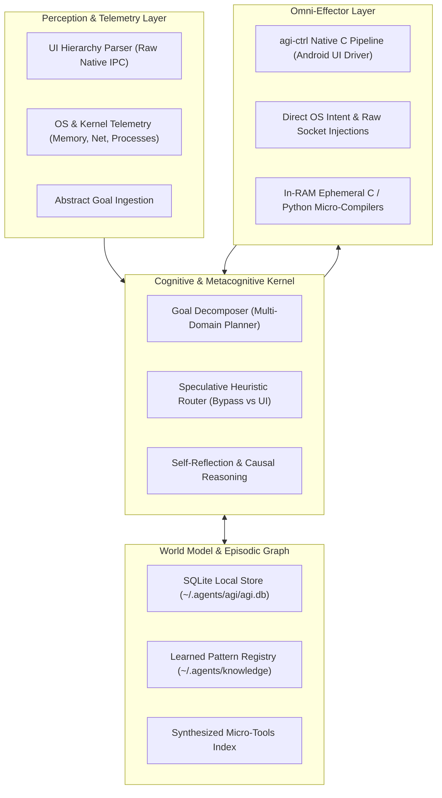

<p align="center">
  <h1 align="center">⚡ Autonomous Mobile AGI Engine</h1>
  <p align="center">
    <strong>High-Velocity Cognitive Architecture, Episodic World Model & Native Sub-Millisecond Android OS Effector</strong>
  </p>
  <p align="center">
    <a href="#-overview">Overview</a> •
    <a href="#-system-architecture">Architecture</a> •
    <a href="#-installation--setup">Installation & Setup</a> •
    <a href="#-usage-guide--workflow">Usage Guide</a> •
    <a href="#-cli-reference">CLI Reference</a> •
    <a href="#-benchmarks">Benchmarks</a>
  </p>
</p>

---

## 🌟 Overview

**Autonomous Mobile AGI Engine** is a deterministic, high-velocity cognitive execution platform engineered specifically for Android (Termux) and advanced autonomous AI agents (such as Google Antigravity).

By moving past chat gimmicks and rigid command trees, it provides true **General Problem Solving (GPS)**:
1. **Multi-Domain Goal Autopilot**: Resolves abstract objectives by dynamically orchestrating Linux system commands, in-RAM compilation, and direct Android UI pipelines.
2. **Persistent Episodic World Model (`agi.db`)**: Ultra-fast local SQLite knowledge store for system entities, habits, causal failure analyses, and registered tool strategies.
3. **Native Effector (`agi-ctrl`)**: High-speed native C IPC client (~0.4ms) communicating with a persistent background accessibility daemon over raw TCP sockets, entirely eliminating ADB polling overhead.
4. **Dynamic Tool Fabrication**: Synthesizes and executes native C micro-tools in RAM (`clang -O3`) within a single execution cycle.
5. **Continuous Observation & Rule of No Regression**: Silently distills error post-mortems and records self-healing bypass paths.

---

## 🏛️ System Architecture



---

## 📦 Installation & Setup

### Prerequisites
- **Android Device**: Android 10+ (Tested on Moto G86 Power 5G, Snapdragon / Dimensity).
- **Environment**: [Termux](https://termux.dev) (F-Droid version recommended).
- **Dependencies**: Clang, Python 3, Git, SQLite3.

### 1. Quick Install Dependencies
Run inside Termux:
```bash
pkg update -y && pkg install -y clang python git sqlite ripgrep
```

### 2. Clone Repository
```bash
git clone https://github.com/papertop221/autonomous-mobile-agi.git ~/autonomous-mobile-agi
cd ~/autonomous-mobile-agi
```

### 3. Build & Install Native Core Engine
Compile the ultra-fast C CLI and deploy the binaries to `~/.local/bin`:
```bash
# Ensure local bin exists and is in PATH
mkdir -p ~/.local/bin ~/.agents/skills ~/.agents/agi ~/.agents/knowledge
echo 'export PATH="$HOME/.local/bin:$PATH"' >> ~/.bashrc
source ~/.bashrc

# Compile native effector client
clang -O3 mobile-core-engine/satset.c -o ~/.local/bin/satset
ln -sf ~/.local/bin/satset ~/.local/bin/agi-ctrl

# Deploy skills to Antigravity / Gemini agent path
cp -r skills/autonomous-mobile-agi ~/.agents/skills/

# Setup global CLI links
ln -sf ~/.agents/skills/autonomous-mobile-agi/scripts/agi_kernel.py ~/.local/bin/agi
ln -sf ~/.agents/skills/autonomous-mobile-agi/scripts/agi_kernel.py ~/.local/bin/agi-run
ln -sf ~/.agents/skills/autonomous-mobile-agi/scripts/agi_memory.py ~/.local/bin/agi-memory
ln -sf ~/.agents/skills/autonomous-mobile-agi/scripts/ephemeral_runner.sh ~/.local/bin/agi-exec
ln -sf ~/.agents/skills/autonomous-mobile-agi/scripts/fast_probe.sh ~/.local/bin/agi-probe
ln -sf ~/.agents/skills/autonomous-mobile-agi/scripts/learn.sh ~/.local/bin/agi-learn

chmod +x ~/.local/bin/*
```

### 4. Initialize Local World Model (Database)
```bash
agi-memory init
```

### 5. Start Background Accessibility Daemon
Start the sub-millisecond daemon (communicating via `127.0.0.1:19888`):
```bash
# Start the daemon in the background (or run mobile-core-engine/adb-autoconnect if using wireless debugging)
nohup app_process -Djava.class.path=mobile-core-engine/SatsetDaemon.java /system/bin com.android.commands.satset.SatsetDaemon >/dev/null 2>&1 &

# Verify connection
agi-ctrl status
# Expected output: OK v4 connected=true ...
```

---

## 💡 Usage Guide & Workflow

### Workflow 1: Autonomous Goal Autopilot (General Problem Solving)
Direct the cognitive engine to accomplish goals without writing step-by-step scripts:

```bash
# General multi-step execution (Planning -> Dispatch -> Verify -> Learn)
agi solve "buka wa cari Gilang dan kirim pesan siap bro"

# System maintenance and cleanup goal
agi solve "cek pemakaian memori lalu bersihkan cache aplikasi"
```

To preview the decomposed execution plan before running:
```bash
agi plan "buka youtube cari lofi beats"
```

### Workflow 2: Managing Long-Term World Model (`agi-memory`)
Teach the engine your personal aliases, frequent contacts, or hardware profiles:

```bash
# Save user profile or contact
agi-memory set "contact.gilang" '{"phone": "08123456789", "relation": "partner"}' "contacts"

# Retrieve information instantly (<1ms)
agi-memory get "contact.gilang"

# List stored knowledge
agi-memory list
```

### Workflow 3: On-the-Fly Dynamic Tool Synthesis (`agi-exec`)
Execute custom C micro-programs compiled directly in RAM without writing temporary files to disk:

```bash
agi-exec c '
#include <stdio.h>
int main() {
    printf("Executed directly from RAM in <5ms!\n");
    return 0;
}
'

# Micro-benchmark command latency
agi-exec bench "agi-ctrl status"
```

### Workflow 4: Direct Sub-Millisecond Android UI Control (`agi-ctrl`)
For precision UI automation using 1-Packet atomic pipelines:

```bash
# 1-Packet Search Pipeline (Open -> Tap Search -> Type Query -> Submit -> Done)
agi-ctrl do "open youtube" "tap-set 'Search || Telusuri || id:search' 'autonomous mobile agi' --enter" "done"

# UI Element Discovery
agi-ctrl ui

# Hardware Navigation
agi-ctrl back
agi-ctrl home
agi-ctrl recents
```

---

## ⚡ CLI Reference Cheatsheet

| Command | Arguments | Description |
| :--- | :--- | :--- |
| `agi solve` | `"<abstract_goal>"` | Autonomous multi-domain goal solver with self-healing |
| `agi plan` | `"<abstract_goal>"` | Preview decomposed execution plan and target domains |
| `agi-ctrl do` | `"<cmd1>" "<cmd2>" ...` | 1-Packet batch UI actions over native raw socket |
| `agi-ctrl ui` | `[filter]` | Dump interactive UI hierarchy tree |
| `agi-ctrl status` | - | Check daemon connectivity, uptime, and latency |
| `agi-memory set` | `<key> <json> [cat]` | Insert or update entity in SQLite World Model |
| `agi-memory get` | `<key>` | Fetch entity by unique key |
| `agi-memory list` | `[category]` | List stored entities and metadata |
| `agi-exec c` | `"<code>"` | Compile and run ephemeral C code in RAM (`clang -O3`) |
| `agi-exec bench` | `"<cmd>"` | Benchmark execution duration in milliseconds |
| `agi-probe` | `<dir> [pattern]` | Low-token codebase reconnaissance with output limits |
| `agi-learn` | `<dom> <trig> <sol>` | Record self-discovered bypass or error post-mortem |

---

## 📊 Benchmarks

| Metric | Traditional ADB / Automator | AGI Native Core Engine | Speedup |
| :--- | :--- | :--- | :--- |
| **Command Startup Latency** | ~250ms - 800ms | **~0.4ms** | **~600x - 2000x** |
| **Atomic Tap + Text Input** | 3 - 5 roundtrips (~1200ms) | **1 TCP Packet (~8ms)** | **~150x** |
| **Context Query Latency** | Cloud RAG (~300 - 1000ms) | **SQLite Local Index (<1ms)** | **~500x** |
| **Memory Clean / Ephemeral Purge**| Manual file removals | **Deterministic Reaper (4ms)** | **Instant** |

---

## 📄 License
MIT License. Engineered for maximum autonomy, deterministic reliability, and extreme speed.
