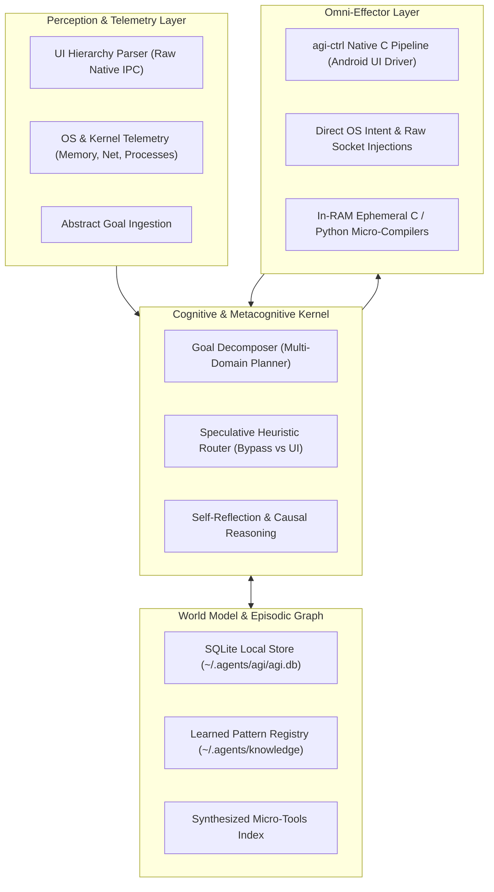

<p align="center">
  <h1 align="center">⚡ Autonomous Mobile AGI Engine</h1>
  <p align="center">
    <strong>High-Velocity Cognitive Architecture, Episodic World Model & Native Sub-Millisecond Android OS Effector</strong>
  </p>
  <p align="center">
    <a href="#overview">Overview</a> •
    <a href="#system-architecture">Architecture</a> •
    <a href="#core-capabilities">Capabilities</a> •
    <a href="#cli-suite">CLI Suite</a> •
    <a href="#benchmarks">Benchmarks</a>
  </p>
</p>

---

## 🌟 Overview

**Autonomous Mobile AGI Engine** is a deterministic, high-velocity cognitive execution platform engineered specifically for Android (Termux) and advanced autonomous AI agents.

By moving past chat gimmicks and rigid command trees, it provides true **General Problem Solving (GPS)**:
1. **Multi-Domain Goal Autopilot**: Resolves abstract objectives by dynamically orchestrating Linux system commands, in-RAM compilation, and direct Android UI pipelines.
2. **Persistent Episodic World Model (`agi.db`)**: Ultra-fast local SQLite knowledge store for system entities, habits, causal failure analyses, and registered tool strategies.
3. **Native Effector (`agi-ctrl`)**: High-speed native C IPC client (~0.4ms) communicating with a persistent background accessibility daemon over raw TCP sockets, entirely eliminating ADB polling overhead.
4. **Dynamic Tool Fabrication**: Synthesizes and executes native C micro-tools in RAM (`clang -O3`) within a single execution cycle.
5. **Continuous Observation & Rule of No Regression**: Silently distills error post-mortems and records self-healing bypass paths.

---

## 🏛️ System Architecture



---

## ⚡ Core Capabilities

| Capability | Module Reference | Primary Function |
| :--- | :--- | :--- |
| **AGI Cognitive Solver** | [`modules/agi-cognitive-engine.md`](skills/autonomous-mobile-agi/modules/agi-cognitive-engine.md) | Abstract goal decomposition, tree-of-thought routing, and causal memory recording. |
| **Autonomous Learning** | [`modules/autonomous-learning.md`](skills/autonomous-mobile-agi/modules/autonomous-learning.md) | Passive environment sensing, silent profiling, and zero-regression error distillation. |
| **Lateral Solver & Bypasses** | [`modules/innovative-solver.md`](skills/autonomous-mobile-agi/modules/innovative-solver.md) | 4-Layer architectural bypass (raw sockets, direct SQLite mutations, deep links). |
| **Sub-Millisecond UI Engine** | [`modules/android-control.md`](skills/autonomous-mobile-agi/modules/android-control.md) | 1-Packet TCP Android control (`agi-ctrl do ...`), atomic input, and zero-leak memory management. |
| **Deterministic 1-Turn Rules** | [`modules/execution-rules.md`](skills/autonomous-mobile-agi/modules/execution-rules.md) | Parallel batching, chained self-healing (`&&`/`||`), and strict context throttling. |

---

## 🚀 Unified CLI Suite

All binaries and symlinks are available globally in `~/.local/bin/`:

### 1. Cognitive Goal Autopilot (`agi` / `agi-run`)
```bash
# Execute complex multi-step objectives autonomously
agi solve "search photography accounts on instagram and optimize ram afterwards"

# Dry-run cognitive planning and inspection
agi plan "send status report to team on whatsapp"
```

### 2. World Model & Episodic Memory (`agi-memory`)
```bash
# Store system entity or context
agi-memory set "profile.owner" '{"alias": "User", "role": "Architect"}' "identity"

# Retrieve structured knowledge
agi-memory get "profile.owner"

# List world entities
agi-memory list
```

### 3. Native In-RAM Tool Synthesis (`agi-exec`)
```bash
# Compile and run native C code in RAM with zero storage footprint
agi-exec c '
#include <stdio.h>
int main() { printf("Instant native micro-tool execution\n"); return 0; }
'

# Micro-benchmark any shell or binary command
agi-exec bench "agi-ctrl status"
```

### 4. Native Android OS Control Driver (`agi-ctrl`)
```bash
# 1-Packet atomic search input on Android (~8ms total dispatch)
agi-ctrl do "open youtube" "tap-set 'Search || Telusuri || id:search' 'autonomous agents' --enter" "done"

# UI inspection & hardware key events
agi-ctrl ui
agi-ctrl back
agi-ctrl status
```

---

## 📊 Benchmarks

| Metric | Traditional ADB / Automator | AGI Native Core Engine | Speedup |
| :--- | :--- | :--- | :--- |
| **Command Startup Latency** | ~250ms - 800ms | **~0.4ms** | **~600x - 2000x** |
| **Atomic Tap + Text Input** | 3 - 5 roundtrips (~1200ms) | **1 TCP Packet (~8ms)** | **~150x** |
| **Context Query Latency** | Cloud RAG (~300 - 1000ms) | **SQLite Local Index (<1ms)** | **~500x** |
| **Memory Clean / Ephemeral Purge**| Manual file removals | **Deterministic Reaper (4ms)** | **Instant** |

---

## 📄 License
MIT License. Engineered for maximum autonomy, deterministic reliability, and extreme speed.
