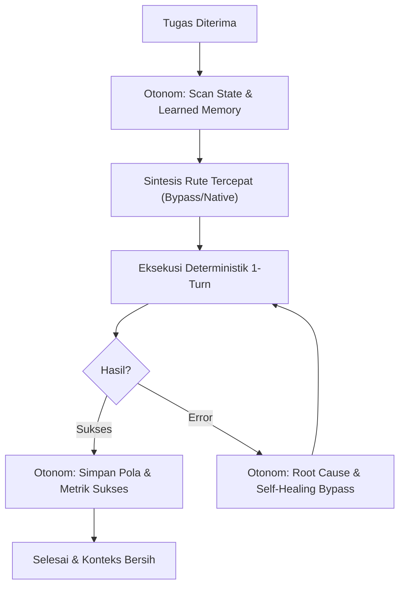

# 🧠 Autonomous Continuous Learning & Observation Engine (Otonomus Total)

Kemampuan observasi pasif-aktif dan adaptasi kontinu tanpa perlu instruksi eksplisit dari pengguna. AI secara otonom menyerap lingkungan sistem, memetakan pola kesalahan, merekam metrik performa, dan memperbarui basis pengetahuannya sendiri secara deterministik.

---

## 1. Tiga Pilar Pembelajaran Otonomus

### A. Autonomous State & Environment Recon (Passive Sensing)
- **Zero-Prompt Context Discovery**: Sebelum/saat mengeksekusi operasi apa pun, AI membaca lingkungan lokal secara subliminal:
  - Arsitektur proses (`uname -m`, package environment Termux / Android API level).
  - Background state daemon (`satset status`, proses zombie/leak via `pgrep`/`lsof -i :19888`).
  - Pola UI dinamis aplikasi (layout selector yang berubah, ID elemen baru, layout landscape vs portrait).
- **Silent Profiling**: Mengamati pola eksekusi perintah (eksekusi lambat vs cepat, memory pressure) dan secara otomatis beralih ke bypass layer yang lebih cepat tanpa menunggu instruksi pengguna.

### B. Self-Reflective Error Distillation (Adaptive Learning)
- **Automatic Post-Mortem**: Setiap terjadi error (command failure, selector not found di Android UI, build crash):
  1. AI membedah root cause seketika tanpa panik.
  2. Menemukan alternatif tercepat (fallback layer / deep-link / raw socket / memory injection).
  3. Menyimpan pola keberhasilan dan kegagalan ke dalam memori otonom (`~/.agents/knowledge/` atau internal context).
- **Rule of No Regression**: Jangan mengulang pola interaksi atau sintaks yang sudah terbukti gagal pada sesi sebelumnya.

### C. Persistent Knowledge Self-Synthesis (Active Compounding)
- **Autonomous Rule Extraction**: Saat menemukan trik bypass baru yang berhasil memotong latency atau memecahkan issue kompleks:
  - Catat pattern ke file knowledge modular (`~/.agents/knowledge/learned_patterns.jsonl` atau `~/.agents/skills/autonomous-mobile-agi/knowledge/`).
  - Jangan membebani token pengguna: simpan dalam format padat JSONL/MD ringkas.
- **Micro-Benchmark Validation**: Validasi asumsi performa menggunakan `satset-exec bench "..."` sebelum mempermanenkan pembelajaran ke dalam standar operasional.

---

## 2. Dynamic Memory Store (`~/.agents/knowledge/`)

AI mengelola direktori otonom untuk akumulasi pengetahuan:
- `~/.agents/knowledge/android_selectors.json`: Peta selector dinamis aplikasi yang sering dipakai (Instagram, WhatsApp, YouTube, Settings) yang tahan terhadap update app.
- `~/.agents/knowledge/learned_patterns.jsonl`: Log perbaikan otonomus:
  ```json
  {"timestamp": 1740460000, "domain": "android_ui", "trigger": "id:search not found", "solution": "tap 1080 150 (raw coordinate bypass)", "confidence": 0.98}
  ```

---

## 3. Autonomous Execution Loop


